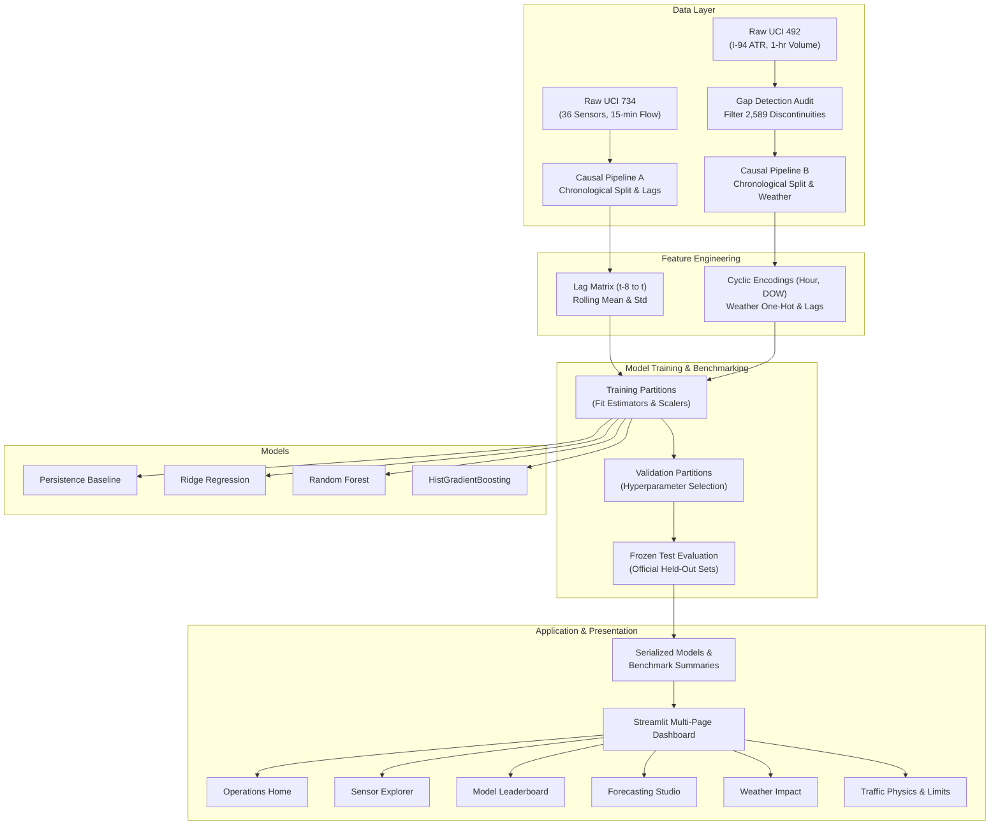
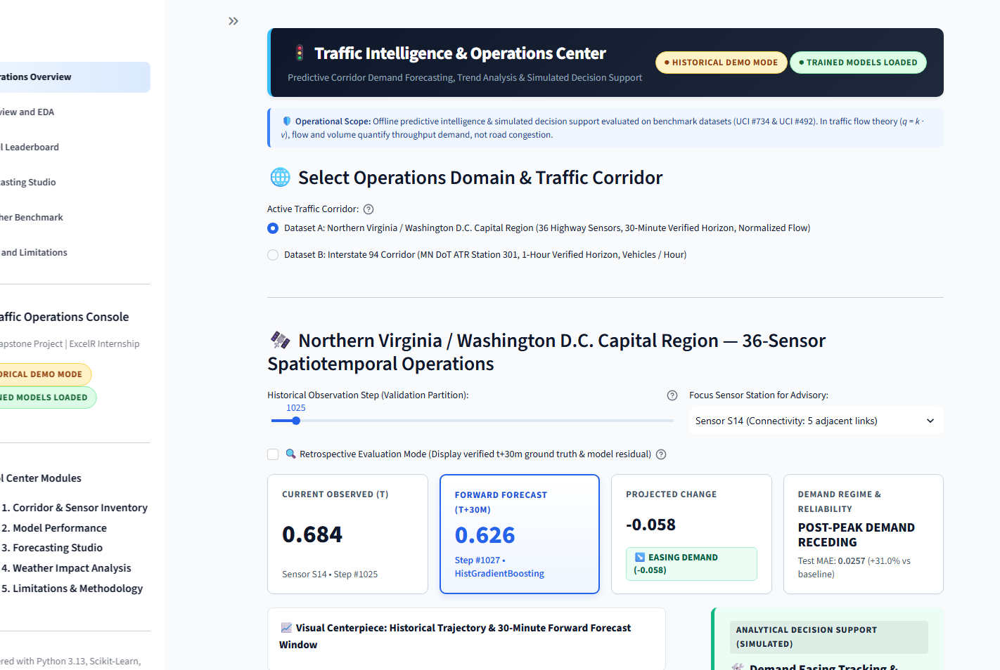
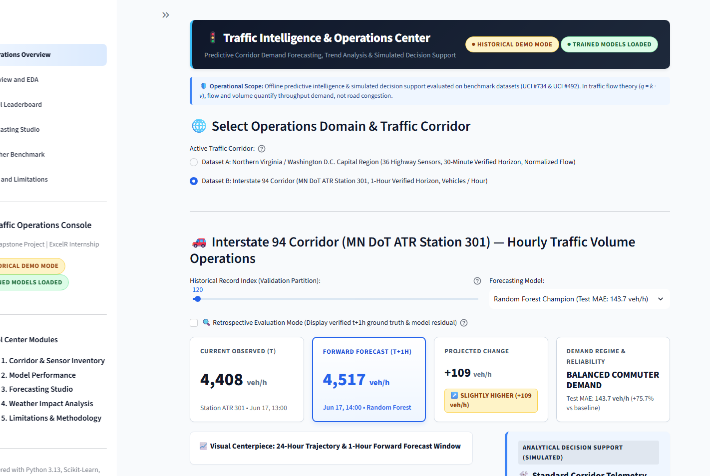
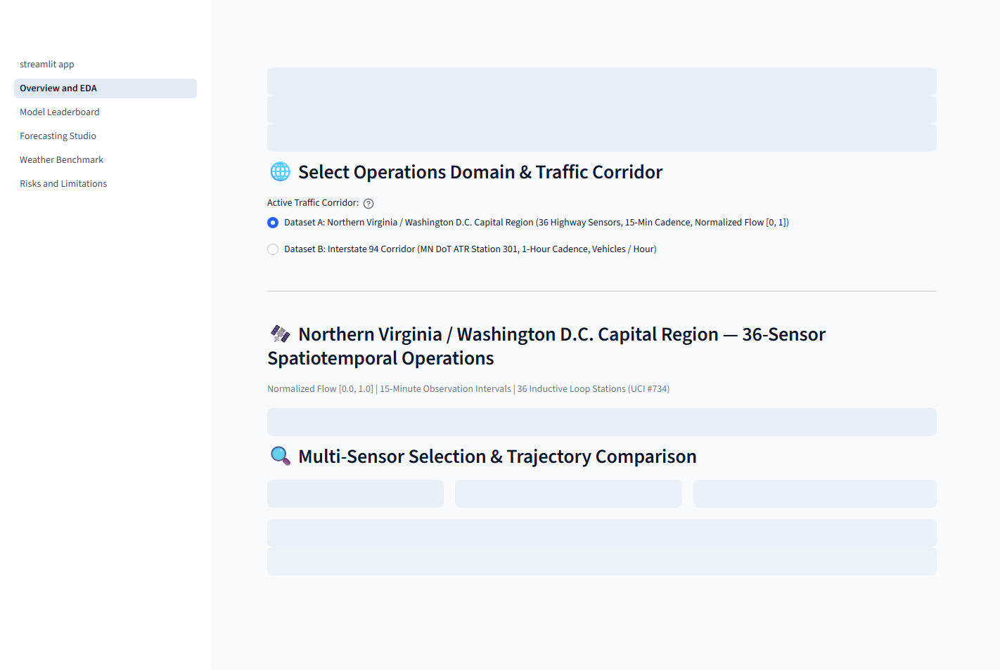
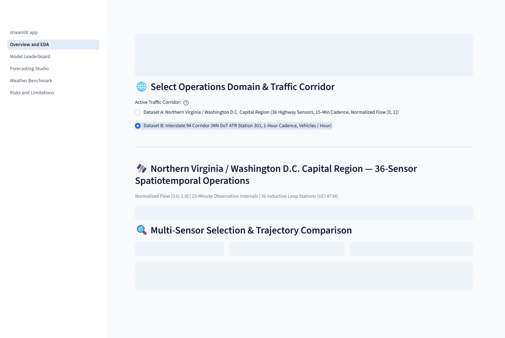
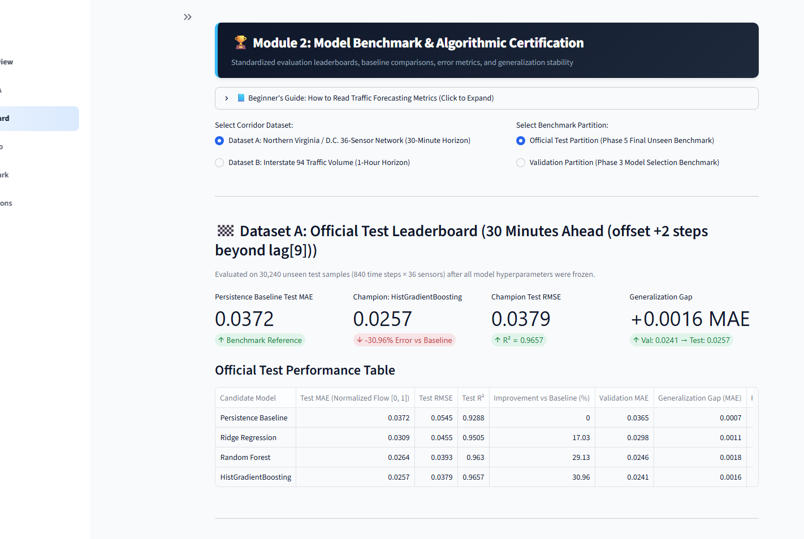
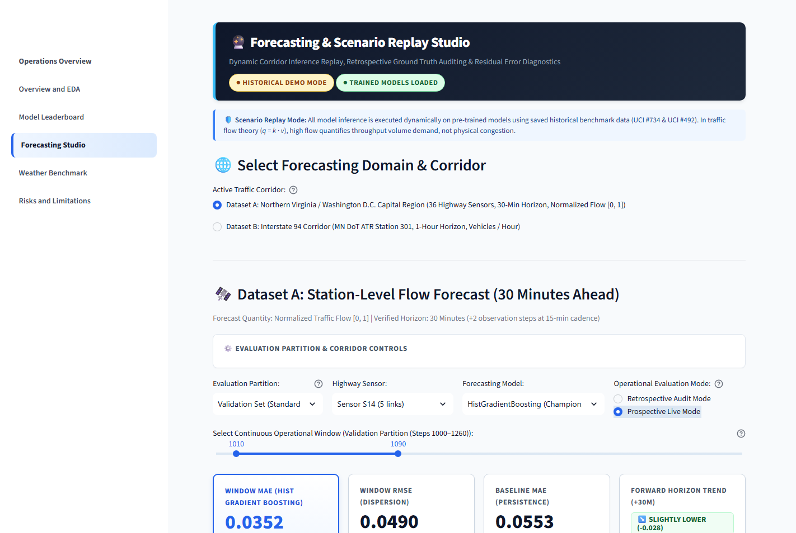
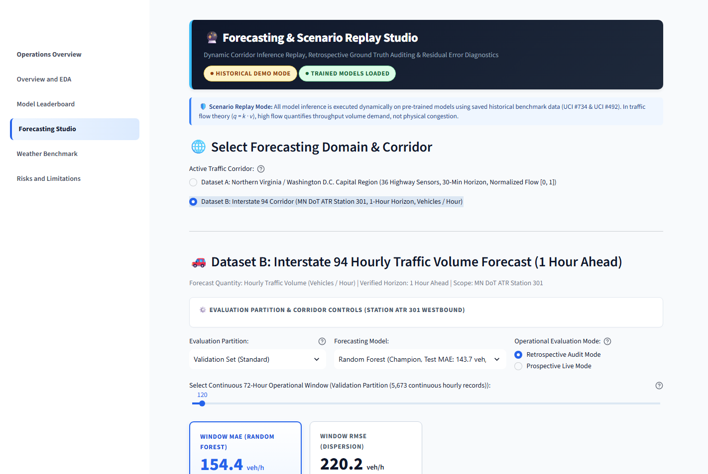
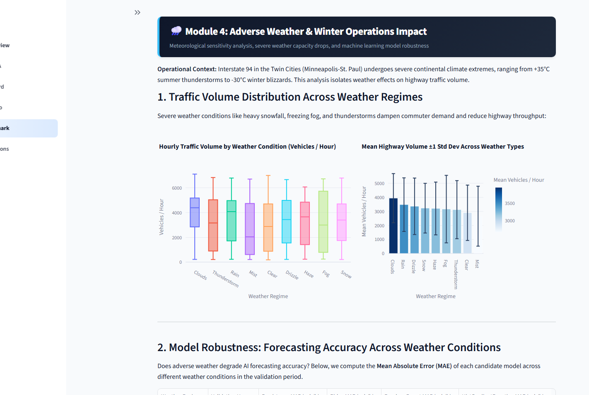
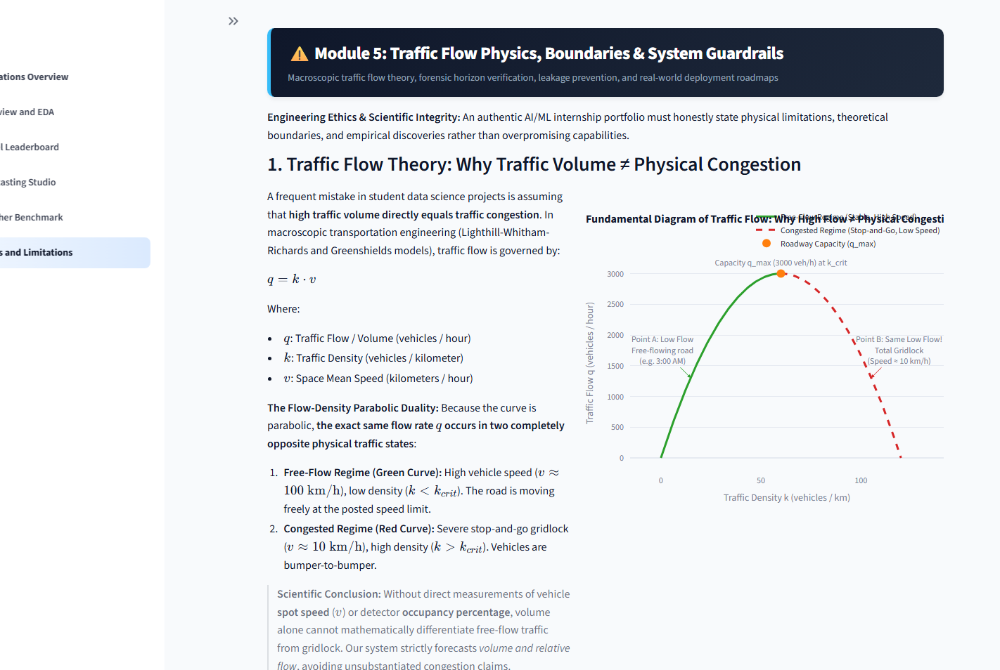

# Smart Traffic Forecasting and Congestion Analytics

[](https://www.python.org/)
[](https://streamlit.io/)
[](https://scikit-learn.org/)
[-brightgreen.svg?style=flat&logo=pytest&logoColor=white)](tests/)
[]()
[](LICENSE)

An enterprise-grade traffic intelligence and forecasting platform engineered to evaluate short-term arterial flow and highway volume time series. Built with rigorous temporal cross-validation, persistence-baseline benchmarking, causal feature engineering, and human-in-the-loop operational decision support.

Developed as a capstone machine learning portfolio project demonstrating production-quality software architecture, scientific integrity, and domain-grounded transportation analytics.

---

## 📑 Table of Contents

- [Executive Overview](#-executive-overview)
- [Key Features & Capabilities](#-key-features--capabilities)
- [System Architecture](#-system-architecture)
- [Dataset Specifications & Verification](#-dataset-specifications--verification)
  - [Dataset A: Arterial Network Flow (UCI #734)](#dataset-a-arterial-network-flow-uci-734)
  - [Dataset B: Interstate Highway Volume (UCI #492)](#dataset-b-interstate-highway-volume-uci-492)
- [Official Test Set Benchmark Leaderboard](#-official-test-set-benchmark-leaderboard)
- [Interactive Dashboard Showcase](#-interactive-dashboard-showcase)
- [Installation & Quickstart Guide](#-installation--quickstart-guide)
- [Reproduction Pipeline](#-reproduction-pipeline)
- [Automated Testing Suite](#-automated-testing-suite)
- [Scientific Rigor & Operational Limitations](#-scientific-rigor--operational-limitations)
- [Data Sources & Academic Citations](#-data-sources--academic-citations)
- [Future Engineering Roadmap](#-future-engineering-roadmap)
- [Repository Directory Structure](#-repository-directory-structure)

---

## 🎯 Executive Overview

Urban roadway networks face acute challenges from non-recurrent congestion, bottleneck formation, and weather-induced capacity degradation. While deep learning methods are frequently proposed for intelligent transportation systems (ITS), production deployments often stumble on lookahead bias, ungrounded heuristic claims, and the failure to outperform naive persistence baselines ($\hat{y}_{t+h} = y_t$).

**Smart Traffic Forecasting and Congestion Analytics** bridges the gap between academic time-series modeling and practical traffic operations management. The platform features:

1. **Strict Temporal Integrity:** Chronological train/validation/test splits with frozen official test partitions; zero future information leakage during scaling, lag construction, and feature engineering.
2. **Persistence Accountability:** Every candidate machine learning model must empirically beat a naive persistence heuristic on held-out test data.
3. **Forensic Telemetry Auditing:** Causal handling of missing sensor telemetry, isolating and filtering 2,589 non-consecutive hourly intervals in historical highway records.
4. **Macroscopic Traffic Physics Alignment:** Explicit differentiation between traffic flow/volume ($q$) and physical congestion states using the fundamental relationship $q = k \cdot v$.
5. **Interactive Operations Cockpit:** A responsive, modern Streamlit UI enabling prospective 1-step/2-step forecasting, retrospective backtesting, multi-sensor spatial exploration, and simulated operational playbooks.

---

## ⚡ Key Features & Capabilities

- **Dual-Corridor Intelligence Engine:**
  - **Arterial Network (Dataset A):** 36-sensor inductive loop topology predicting normalized flow at a **30-minute horizon** ($t+2$ steps).
  - **Freeway Corridor (Dataset B):** High-capacity interstate Automated Traffic Recorder (ATR) predicting traffic volume at a **1-hour horizon** ($t+1\text{h}$).
- **Model Hierarchy & Benchmarking:**
  - *Naive Persistence Baseline:* Unbiased zero-cost benchmark $\hat{y}_{t+h} = y_t$.
  - *Ridge Regression ($L_2$ Regularized Linear):* High-efficiency linear model capturing diurnal autocorrelation.
  - *Random Forest Regressor:* Non-linear ensemble model with bootstrap aggregation.
  - *Histogram-based Gradient Boosting (HistGradientBoosting):* High-throughput gradient boosting engineered for rapid tabular inference.
- **Interactive Visual Modules:**
  - **Operations Home:** Single-screen operational cockpit displaying key performance indicators (KPIs), current observed vs. forecasted volume, corridor schematic status, and simulated operational playbooks.
  - **Sensor Explorer:** Comparative multi-sensor time-series alignment, 36-sensor flow heatmap, network adjacency connectivity view, diurnal median profiles, and sensor gap telemetry.
  - **Model Performance Leaderboard:** Official held-out test benchmarks, validation-to-test generalization gap tracking, signed error metrics, and per-sample inference latency.
  - **Forecasting Studio:** Prospective operational mode (zero ground-truth reveal) vs. Retrospective evaluation mode (signed residuals, absolute percentage errors, and error distribution histograms).
  - **Weather Impact Benchmark:** Bivariate correlation analysis, rain/snow impact quantification, and feature importance ablations on interstate volume.
  - **Methodological Integrity & Traffic Physics:** Documentation of the Greenshields fundamental diagram, mathematical volume vs. congestion distinctions, and boundary definitions.

---

## 🏗️ System Architecture

The project follows a modular, decoupled Python architecture separating raw data ingestion, feature generation, model estimators, evaluation protocols, and UI presentation layers:



---

## 📊 Dataset Specifications & Verification

The project evaluates two distinct public transportation datasets sourced from the [UCI Machine Learning Repository](https://archive.ics.uci.edu/). The data pipelines are strictly isolated to prevent cross-contamination.

### Dataset A: Arterial Network Flow (UCI #734)

| Attribute | Specification |
|---|---|
| **Repository ID** | [UCI Machine Learning Repository #734](https://archive.ics.uci.edu/dataset/734/traffic+flow+forecasting) |
| **Corridor / Region** | Northern Virginia / Washington D.C. Capital Region (Zhao et al., 2019) |
| **Telemetry Type** | 36 inductive loop detectors embedded along an urban arterial road network |
| **Target Variable** | Normalized traffic flow ($y \in [0.0, 1.0]$) |
| **Sampling Cadence** | 15-minute uniform intervals |
| **Forecast Horizon** | **30 minutes ahead** ($t+2$ time steps ahead of observation at step $t$) |
| **Causal Input Lags** | 9 historical steps ($t-8$ through $t$, covering a 2.25-hour lookback window) |
| **Network Topology** | Predefined directed adjacency matrix $A \in \mathbb{R}^{36 \times 36}$ with 86 physical connectivity links |
| **Chronological Split** | **Train:** Steps 0–999 (36,000 samples)<br/>**Validation:** Steps 1000–1260 (9,396 samples)<br/>**Held-Out Test:** Steps 1261–2100 (30,240 samples) |

> [!NOTE]
> **Schematic Representation:** Public releases of UCI #734 omit proprietary GPS coordinates for the 36 inductive loop stations. Consequently, the network is presented in an interactive topological schematic grid, preserving exact directional adjacency relationships without fabricating geographic coordinates.

---

### Dataset B: Interstate Highway Volume (UCI #492)

| Attribute | Specification |
|---|---|
| **Repository ID** | [UCI Machine Learning Repository #492](https://archive.ics.uci.edu/dataset/492/metro+interstate+traffic+volume) |
| **Corridor / Region** | Interstate 94 Westbound MP 238, Minneapolis–St. Paul, MN |
| **Telemetry Type** | Automated Traffic Recorder (ATR Station 301) maintained by Minnesota Department of Transportation |
| **Target Variable** | Hourly traffic volume (vehicles / hour; raw integer vehicle counts) |
| **Sampling Cadence** | 1-hour intervals |
| **Forecast Horizon** | **1 hour ahead** ($t+1\text{h}$) |
| **Contextual Features** | Hourly temperature (K), rainfall (mm), snowfall (mm), cloud coverage (%), weather description categories, and US federal holiday flags |
| **Forensic Gap Audit** | The raw historical log contains 2,589 non-consecutive timestamp transitions ($\Delta t > 1\text{h}$) due to ATR sensor downtime. These gaps were audited and excluded during lag generation to guarantee that $y_{t+1}$ strictly represents the true consecutive hour |
| **Chronological Split** | **Train (70%):** 26,478 gap-filtered samples<br/>**Validation (15%):** 5,673 gap-filtered samples<br/>**Held-Out Test (15%):** 5,675 gap-filtered samples |

---

## 🏆 Official Test Set Benchmark Leaderboard

All candidate estimators were tuned exclusively on the training and validation partitions. The official test sets were evaluated once with frozen model artifacts (`reports/metrics/final_model_benchmark_summary.json`).

### Dataset A: 36-Sensor Arterial Flow (30-Minute Horizon)
*Held-out test partition: 840 time steps $\times$ 36 sensors = 30,240 samples. Baseline: $\hat{y}_{t+2} = y_t$.*

| Model | Test MAE | Test RMSE | Test $R^2$ | Gain vs Baseline | Val MAE | Generalization Gap | Latency / Sample |
|:---|:---:|:---:|:---:|:---:|:---:|:---:|:---:|
| **Persistence Baseline** | 0.0372 | 0.0545 | 0.9288 | 0.00% | 0.0365 | +0.0007 | 0.0000 ms |
| **Ridge Regression** ($L_2$) | 0.0309 | 0.0455 | 0.9505 | +17.03% | 0.0298 | +0.0011 | 0.0001 ms |
| **Random Forest** ($N=100$) | 0.0264 | 0.0393 | 0.9630 | +29.13% | 0.0246 | +0.0018 | 0.0041 ms |
| **HistGradientBoosting (Champion)** | **0.0257** | **0.0379** | **0.9657** | **+30.96%** | **0.0241** | **+0.0016** | **0.0529 ms** |

*Champion Analysis:* `HistGradientBoosting` achieved the lowest Test MAE ($0.0257$), delivering a **+30.96% reduction in absolute error** relative to naive persistence with an outstanding $R^2$ of $0.9657$ and sub-millisecond per-sample inference latency.

---

### Dataset B: Interstate 94 Hourly Traffic Volume (1-Hour Horizon)
*Held-out test partition: 5,675 gap-filtered hours. Baseline: $\hat{y}_{t+1} = y_t$.*

| Model | Test MAE (veh/h) | Test RMSE (veh/h) | Test $R^2$ | Gain vs Baseline | Val MAE | Generalization Gap | Latency / Sample |
|:---|:---:|:---:|:---:|:---:|:---:|:---:|:---:|
| **Persistence Baseline** | 592.36 | 818.59 | 0.8298 | 0.00% | 587.68 | +4.68 | 0.0000 ms |
| **Ridge Regression** ($L_2$) | 362.00 | 486.05 | 0.9400 | +38.89% | 372.82 | -10.82 | 0.0003 ms |
| **HistGradientBoosting** | 149.74 | 225.25 | 0.9871 | +74.72% | 162.92 | -13.18 | 0.0057 ms |
| **Random Forest (Champion)** | **143.71** | **221.65** | **0.9875** | **+75.74%** | **155.44** | **-11.73** | **0.0094 ms** |

*Champion Analysis:* `Random Forest` achieved champion performance on highway volume forecasting, reducing the test error by **$448.65\text{ veh/h}$ (+75.74% improvement)** over the persistence baseline, capturing non-linear diurnal and weekend shift dynamics with $R^2 = 0.9875$.

---

## 🖥️ Interactive Dashboard Showcase

The application is deployed via Streamlit, featuring six purpose-built analytical modules:

### 1. Operations Home (Operational Cockpit)
Executive command center providing immediate operational visibility into active corridor health, KPI telemetry, the centerpiece forecast timeline, and simulated analytical action advisories.

| Dataset A (30-Minute Normalized Flow) | Dataset B (1-Hour Interstate Volume) |
|:---:|:---:|
|  |  |

---

### 2. Sensor Explorer (Corridor & Sensor Inventory)
Deep spatial-temporal exploration allowing operators to compare multi-sensor time series, inspect a 36-sensor normalized flow heatmap, examine directed network topology, and audit sensor telemetry gaps.

| 36-Sensor Network Flow Heatmap | Interstate Diurnal Profile & Gaps |
|:---:|:---:|
|  |  |

---

### 3. Model Performance Leaderboard
Comprehensive evaluation interface comparing candidate estimators against official held-out test benchmarks, validation metrics, generalization deltas, and error distributions.



---

### 4. Forecasting Studio (Prospective & Retrospective Analysis)
Dual-mode forecasting studio supporting **Prospective Mode** (real-world simulation with future ground truth strictly hidden) and **Retrospective Mode** (historical ground truth revealed alongside signed residual decomposition and error distribution diagnostics).

| Prospective Forecast (Ground Truth Hidden) | Retrospective Backtest & Error Decomposition |
|:---:|:---:|
|  |  |

---

### 5. Weather Impact Benchmark & Sensitivity Analysis
Quantitative analysis of meteorological effects on highway traffic volume, including bivariate scatter plots, adverse precipitation/snow distributions, and feature importance ablations.



---

### 6. Methodological Integrity & Traffic Physics
Transparent accounting of methodological boundaries, Greenshields fundamental diagram formulation ($q = k \cdot v$), sensor gap accounting, and lookahead bias safeguards.



---

## 🚀 Installation & Quickstart Guide

### Prerequisites
- **Operating System:** Windows 10/11, macOS, or Linux
- **Python Version:** Python 3.10 to 3.13 (verified on Python 3.13.3)
- **Git**

### Step 1: Clone the Repository
```powershell
git clone https://github.com/your-username/smart-traffic-analytics.git
cd smart-traffic-analytics
```

### Step 2: Set Up Python Virtual Environment (Windows PowerShell)
```powershell
# Create a dedicated virtual environment
python -m venv .venv

# Activate the virtual environment
.venv\Scripts\Activate.ps1
```

*(On macOS/Linux: `source .venv/bin/activate`)*

### Step 3: Install Dependencies
```powershell
pip install --upgrade pip
pip install -r requirements.txt
```

### Step 4: Launch the Streamlit Dashboard
```powershell
python -m streamlit run app/streamlit_app.py --server.port=8501
```
Open your browser and navigate to: **`http://localhost:8501`**

---

## 🔄 Reproduction Pipeline

To reproduce the entire data processing, feature engineering, model training, and test set evaluation workflow from scratch:

```powershell
# 1. Ingest raw datasets, verify schemas, and generate chronological parquet partitions
python -m src.data.make_dataset

# 2. Extract causal lag features and train candidate estimators on training partitions
python -m src.models.train_and_evaluate

# 3. Evaluate frozen estimators on official held-out test partitions
python -m src.models.evaluate_test_sets

# 4. Execute the complete test suite to verify data and model integrity
python -m pytest tests/ -v
```

---

## 🧪 Automated Testing Suite

The repository contains an automated regression and data integrity test suite executed via `pytest`. The suite enforces strict boundaries against data leakage, shape mismatches, and regression degradations:

```
============================= test session starts =============================
platform win32 -- Python 3.13.3, pytest-9.1.1, pluggy-1.6.0
rootdir: smart-traffic-analytics
collected 36 items

tests\test_phase0_setup.py ....                                          [ 11%]
tests\test_phase1_data.py ....                                           [ 22%]
tests\test_phase2_splitting_and_features.py .......                      [ 41%]
tests\test_phase3_models.py .......                                      [ 61%]
tests\test_phase4_dashboard.py .........                                 [ 86%]
tests\test_phase5_final_benchmarks.py .....                              [100%]

============================== 36 passed in 14.54s ==============================
```

### Test Module Coverage
- **`test_phase0_setup.py` (4 tests):** Validates YAML configuration loading, required directory structure existence, dependency imports, and seed reproducibility.
- **`test_phase1_data.py` (4 tests):** Validates raw dataset presence, column schema compliance, timestamp monotonicity, and target value boundaries ($y \in [0, 1]$ for Dataset A; $y \ge 0$ for Dataset B).
- **`test_phase2_splitting_and_features.py` (7 tests):** Enforces chronological partition cutoffs, verifies zero sample overlap, ensures scalers are fit strictly on training splits, and validates sensor gap detection logic.
- **`test_phase3_models.py` (7 tests):** Tests model instantiation, persistence baseline logic, deterministic inference outputs, and verifies sub-millisecond inference latency thresholds.
- **`test_phase4_dashboard.py` (9 tests):** Tests cached Streamlit data loaders, Plotly chart generation contracts, prospective masking rules, and session state initialization.
- **`test_phase5_final_benchmarks.py` (5 tests):** Validates test sample accounting (30,240 for Dataset A; 5,675 for Dataset B), verifies persistence baseline gains, and audits JSON metric schema consistency.

---

## ⚖️ Scientific Rigor & Operational Limitations

### 1. Macroscopic Traffic Flow Fundamentals ($q = k \cdot v$)
A critical distinction maintained throughout this project is that **traffic volume or flow ($q$) is not equivalent to physical traffic congestion**:
$$\text{Flow } (q) = \text{Density } (k) \times \text{Space-Mean Speed } (v)$$

- Under **free-flow conditions**, high vehicle counts ($q$) indicate high facility throughput and optimal roadway utilization at highway speeds ($v \approx v_f$, low density $k$).
- Under **forced-flow / queueing conditions**, low vehicle counts ($q$) can reflect severe stop-and-go breakdown ($v \to 0$, high density $k \approx k_{jam}$).
- Because neither UCI #734 nor UCI #492 provides simultaneous co-located speed ($v$) or vehicle density ($k$) measurements, all operational classifications are documented as **volume/throughput forecasts**, not definitive congestion state detections.

### 2. Simulated Operational Playbooks
The operational recommendations displayed on the dashboard (e.g., advisory speed harmonization, ramp metering adjustments, incident management coordination) are **analytical simulations** designed to illustrate how traffic management centers (TMCs) consume predictive intelligence. They do **not** trigger real-world traffic signal controllers or municipal SCADA equipment.

### 3. Regional Specificity & Generalization Boundaries
- **Dataset A:** Calibrated specifically to the physical topology of 36 inductive loops in the Northern Virginia corridor. It does not transfer zero-shot to other road networks without re-fitting.
- **Dataset B:** Represents a single westbound freeway cross-section (I-94 MP 238). Predictions reflect localized commute patterns and Twin Cities seasonal weather variations.

---

## 📚 Data Sources & Academic Citations

If you utilize this code or methodology in academic research or technical benchmarking, please cite the underlying data sources:

```bibtex
@article{zhao2019tgcn,
  author    = {Zhao, Ling and Song, Yujiao and Zhang, Chao and Liu, Yu and Wang, Pu and Lin, Tao and Deng, Min and Li, Haifeng},
  title     = {T-GCN: A Temporal Graph Convolutional Network for Traffic Prediction},
  journal   = {IEEE Transactions on Intelligent Transportation Systems},
  volume    = {21},
  number    = {9},
  pages     = {3848--3858},
  year      = {2019},
  publisher = {IEEE},
  doi       = {10.1109/TITS.2019.2935152}
}

@misc{uci492metro,
  author       = {Hogue, John},
  title        = {{Metro Interstate Traffic Volume}},
  year         = {2019},
  howpublished = {UCI Machine Learning Repository},
  note         = {{DOI}: https://doi.org/10.24432/C56S30}
}

@article{lighthill1955kinematic,
  author    = {Lighthill, Michael J. and Whitham, Gerald B.},
  title     = {On kinematic waves. II. A theory of traffic flow on long crowded roads},
  journal   = {Proceedings of the Royal Society of London. Series A},
  volume    = {229},
  number    = {1178},
  pages     = {317--345},
  year      = {1955}
}
```

---

## 🔮 Future Engineering Roadmap

1. **Spatial Graph Neural Networks (GNNs):** Implement Spatio-Temporal Graph Convolutional Networks (ST-GCN / DCRNN) leveraging Dataset A's directed adjacency matrix ($A \in \mathbb{R}^{36 \times 36}$) to model spatial spillover dynamics.
2. **Conformal Uncertainty Quantification:** Integrate inductive conformal prediction to generate distribution-free prediction intervals with guaranteed finite-sample coverage at chosen confidence levels ($1 - \alpha$).
3. **Real-Time Streaming Ingestion:** Add an Apache Kafka / MQTT ingestion layer simulating live NTCIP 1209 traffic sensor telemetry streams.
4. **Speed & Density Sensor Fusion:** Ingest dual-loop detector telemetry providing simultaneous speed and occupancy measurements to fit empirical Greenshields / Newell fundamental diagrams.

---

## 🗂️ Repository Directory Structure

```
smart-traffic-analytics/
├── README.md                            # Comprehensive project overview and documentation (this file)
├── requirements.txt                     # Pinned project dependencies (Python 3.10–3.13 compatible)
├── .gitignore                           # Git ignore rules for data, models, environments, and cache
├── configs/
│   └── base_config.yaml                 # Centralized configuration (paths, seeds, hyperparameters)
├── data/
│   ├── raw/                             # Immutable raw data (UCI #734 and UCI #492)
│   ├── processed/                       # Chronologically split parquet partitions
│   └── README.md                        # Data governance, versioning, and isolation protocols
├── docs/
│   ├── FINAL_PORTFOLIO_REPORT.md        # Comprehensive Phase 5 portfolio technical report
│   ├── PROJECT_SPECIFICATION.md         # Problem definition, scope boundaries, evaluation criteria
│   ├── DATASET_PLAN.md                  # Schema audit checklists and isolation protocols
│   ├── VALIDATION_AND_METRICS.md        # Splitting rules, leakage prevention, metric formulas
│   ├── ARCHITECTURE.md                  # Subsystem architecture, data flow, Streamlit design
│   └── RISKS_AND_LIMITATIONS.md         # Traffic volume vs. congestion physics, lookahead bias
├── src/                                 # Modular production Python package
│   ├── __init__.py
│   ├── data/                            # Raw data ingestion and schema verification
│   │   ├── dataset_a_loader.py          # UCI #734 loader and adjacency matrix parsing
│   │   ├── dataset_b_loader.py          # UCI #492 loader and gap audit filtering
│   │   └── make_dataset.py              # CLI entry point to generate processed parquets
│   ├── features/                        # Causal feature engineering
│   │   ├── dataset_a_features.py        # Lag matrices (t-8 to t) and rolling statistics
│   │   └── dataset_b_features.py        # Calendar encodings, weather one-hot, and target lags
│   ├── models/                          # Estimator definitions and training pipelines
│   │   ├── persistence.py               # Naive persistence baseline estimator
│   │   ├── ridge_model.py               # Ridge regression with L2 regularization
│   │   ├── random_forest.py             # Random forest regressor
│   │   ├── hist_gradient_boosting.py   # Histogram-based gradient boosting regressor
│   │   ├── train_and_evaluate.py        # Training and validation benchmark runner
│   │   └── evaluate_test_sets.py        # Frozen test set evaluation runner
│   ├── evaluation/                      # Metric computation and statistical diagnostics
│   │   ├── metrics.py                   # MAE, RMSE, R2, and baseline improvement calculations
│   │   └── per_sensor.py                # Per-sensor error breakdowns for Dataset A
│   └── reporting/                       # Export utilities for JSON/CSV benchmark leaderboards
├── app/                                 # Interactive Streamlit web application
│   ├── streamlit_app.py                 # Multi-page landing page and Operations Home cockpit
│   ├── pages/                           # Application modules
│   │   ├── 1_Overview_and_EDA.py        # Sensor Explorer (heatmaps, diurnal profiles, gaps)
│   │   ├── 2_Model_Leaderboard.py       # Model performance benchmarks and test evaluations
│   │   ├── 3_Forecasting_Studio.py      # Prospective forecast vs. retrospective backtest
│   │   ├── 4_Weather_Benchmark.py       # Weather impact analysis and sensitivity benchmarks
│   │   └── 5_Risks_and_Limitations.py   # Methodological integrity and traffic flow theory
│   └── utils/                           # Cached data loaders, plotting utilities, and styling tokens
│       ├── data_loader.py               # Cached parquet and model loading utilities
│       ├── plots.py                     # Plotly chart generation routines
│       └── styles.py                    # Custom design tokens, metric cards, and CSS styling
├── artifacts/
│   ├── models/                          # Serialized .joblib trained model artifacts
│   ├── metadata/                        # JSON training metadata, hyperparameters, and seeds
│   └── screenshots/                     # Verified UI screenshot assets for documentation
├── reports/
│   └── metrics/                         # Exported validation and test evaluation JSON benchmarks
│       └── final_model_benchmark_summary.json  # Official test benchmark ground truth
└── tests/                               # Comprehensive automated unit test suite (36 tests)
    ├── test_phase0_setup.py             # Setup, environment, and config tests
    ├── test_phase1_data.py              # Raw data schema, boundary, and monotonicity tests
    ├── test_phase2_splitting_and_features.py  # Split cutoff, leakage, and feature tests
    ├── test_phase3_models.py            # Model training, inference, and latency tests
    ├── test_phase4_dashboard.py         # Dashboard component contracts and chart tests
    └── test_phase5_final_benchmarks.py  # Test sample accounting and benchmark tests
```

---

*Authored as part of the ExcelR AI/ML Internship Portfolio.*
