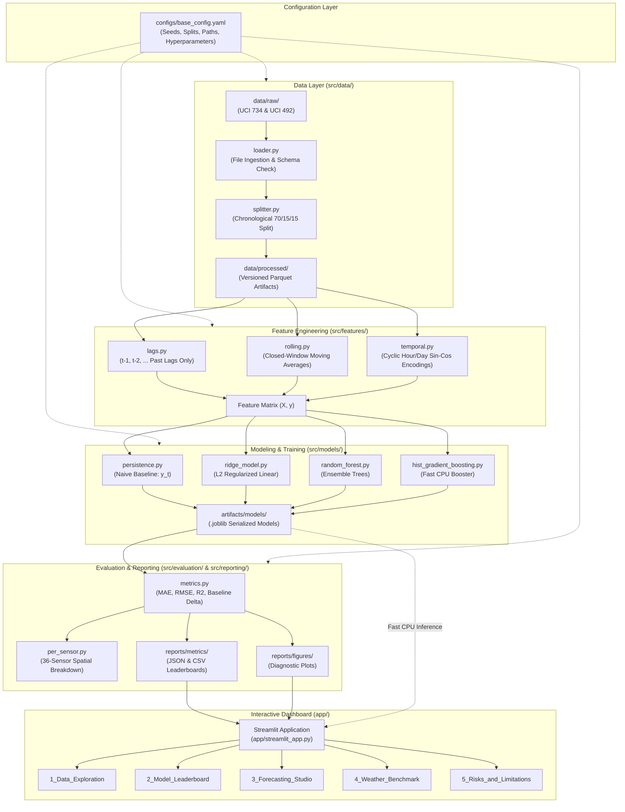

# Software Architecture & Engineering Design

**Document Version:** 1.0.0 (Phase 0)  
**Author:** AI/ML Engineering Pair  
**Project:** Smart Traffic Forecasting and Congestion Analytics  
**Status:** Pre-Implementation Specification

---

## 1. Architectural Philosophy and Design Principles

The architecture of **Smart Traffic Forecasting and Congestion Analytics** is engineered to bridge academic machine learning with production software standards. Many student data science repositories suffer from monolithic, messy Jupyter Notebooks where feature transformations, model training, and plotting are tangled together.

This project enforces four foundational software engineering principles:
1. **Decoupled Modularity:** Every processing stage (data validation, feature engineering, model training, evaluation, UI presentation) is isolated in dedicated Python modules with well-defined APIs.
2. **Deterministic Reproducibility:** Data splits, random seeds, hyperparameter spaces, and directory paths are governed by declarative YAML configuration files (`configs/base_config.yaml`).
3. **CPU-First Performance:** Given Windows 11 host constraints (Intel Iris Xe graphics, 16 GB RAM), memory allocations use vectorization (`numpy`, `pandas`) and cache-friendly CPU tree algorithms (`HistGradientBoostingRegressor`).
4. **Strict Separation of Training and Serving:** Model training and hyperparameter searches run strictly offline via CLI modules. The interactive Streamlit dashboard functions solely as a lightweight, read-only consumer of serialized models and evaluation summaries.

---

## 2. High-Level System Architecture

The following diagram illustrates data flow and dependencies across the system components:



---

## 3. Directory Structure and Package Breakdown

```
smart-traffic-analytics/
├── .gitignore                      <- Version control exclusions (data, artifacts, env)
├── README.md                       <- High-level project summary and quickstart
├── requirements.txt                <- Python package dependencies (compatible with Python 3.13)
├── configs/
│   └── base_config.yaml            <- Centralized project configuration
├── data/
│   ├── raw/                        <- Immutable original downloads (.gitkeep)
│   ├── processed/                  <- Cleaned chronological splits (.gitkeep)
│   └── README.md                   <- Data governance documentation
├── docs/
│   ├── PROJECT_SPECIFICATION.md    <- Scope, boundaries, and roadmap
│   ├── DATASET_PLAN.md             <- Dataset audit protocols (UCI 734 & UCI 492)
│   ├── VALIDATION_AND_METRICS.md   <- Splitting, leakage prevention, and metrics
│   ├── ARCHITECTURE.md             <- This architecture specification
│   └── RISKS_AND_LIMITATIONS.md    <- Real-world risks, congestion vs volume
├── src/                            <- Core production-grade Python library
│   ├── __init__.py
│   ├── data/                       <- Ingestion, schema audit, chronological splitting
│   │   └── __init__.py
│   ├── features/                   <- Lags, rolling windows, cyclic encodings
│   │   └── __init__.py
│   ├── models/                     <- Model definitions, persistence, estimators
│   │   └── __init__.py
│   ├── evaluation/                 <- MAE, RMSE, R2, per-sensor aggregations
│   │   └── __init__.py
│   ├── forecasting/                <- Forward inference routines, error bounds
│   │   └── __init__.py
│   ├── monitoring/                 <- Data health, drift, runtime profiling
│   │   └── __init__.py
│   └── reporting/                  <- Automated markdown/table report builders
│       └── __init__.py
├── app/                            <- Streamlit interactive web dashboard
│   ├── __init__.py
│   ├── pages/                      <- Multi-page dashboard modules (.gitkeep)
│   └── components/                 <- Reusable UI widgets and chart renderers (.gitkeep)
├── artifacts/                      <- Serialized model weights and run metadata
│   ├── models/                     <- Saved .joblib model files (.gitkeep)
│   └── metadata/                   <- Run hashes, environment logs, hyperparameters (.gitkeep)
├── reports/                        <- Generated outputs and reproducible figures
│   ├── figures/                    <- PNG/SVG diagnostic and forecast plots (.gitkeep)
│   └── metrics/                    <- CSV/JSON evaluation leaderboards (.gitkeep)
├── notebooks/                      <- Exploratory scratchpads (prototyping only) (.gitkeep)
└── tests/                          <- Automated test suite (pytest)
    └── __init__.py
```

---

## 4. Subsystem Details

### 4.1 Data Processing (`src/data/`)
- **Data Ingestion:** Reads raw files with strict error-handling for missing columns, corrupt lines, or unexpected delimiters.
- **Chronological Splitter:** Computes partition cutoffs without shuffling. Guarantees that multi-sensor records with identical timestamps stay in the same split.
- **Serialization:** Saves processed splits into columnar Apache Parquet format to ensure fast I/O and minimal memory overhead.

### 4.2 Feature Engineering (`src/features/`)
- **Lags Generator:** Creates lagged regressors $y_{t-1}, y_{t-2}, \dots, y_{t-k}$ with strictly positive shift indices (+1 or greater).
- **Rolling Windows:** Computes moving averages and rolling standard deviations with `closed='left'` to ensure observations at prediction time $t$ do not leak into history.
- **Cyclic Calendar Encodings:** Transforms hour-of-day ($h \in [0, 23]$) and day-of-week ($d \in [0, 6]$) into continuous sinusoidal waves:
  $$\sin\left(\frac{2\pi \cdot h}{24}\right), \quad \cos\left(\frac{2\pi \cdot h}{24}\right)$$
  This captures cyclical temporal continuity (hour 23 is immediately adjacent to hour 0).

### 4.3 Model Architecture & Training (`src/models/`)
- Implements a uniform estimator interface compatible with `scikit-learn` conventions (`fit(X, y)`, `predict(X)`).
- Wraps:
  1. `PersistenceForecaster`: Baseline returning the most recent observed lag ($y_{t-1}$).
  2. `RidgeRegressionForecaster`: Fast linear shrinkage baseline.
  3. `RandomForestForecaster`: Multi-threaded decision tree ensemble.
  4. `HistGradientBoostingForecaster`: Optimized histogram gradient booster.
- Exports trained models with `joblib` into `artifacts/models/`.

### 4.4 Evaluation & Reporting (`src/evaluation/` & `src/reporting/`)
- Computes MAE, RMSE, $R^2$, and baseline improvement percentages.
- Computes per-sensor performance tables and spatial error distributions across the 36 stations.
- Automatically exports machine-readable JSON/CSV summaries into `reports/metrics/`.

### 4.5 Interactive Analytics Dashboard (`app/`)
Built with Streamlit, the application contains five modular pages:
1. **Overview & Exploratory Analysis:** Data completeness, timeline view, sensor correlation matrix.
2. **Model Leaderboard:** Comprehensive comparison table (MAE, RMSE, $R^2$, training duration, disk footprint).
3. **Forecasting Studio:** Interactive time slider to inspect 15-minute predictions against ground truth for individual sensors during rush hours vs off-peak hours.
4. **Weather Impact Benchmark (Dataset B):** Direct comparison between traffic-only vs weather-augmented models.
5. **Operational Limitations & System Health:** Technical disclosures, memory usage profiling, and non-congestion advisory.

---

## 5. Artifact and Metadata Governance

To ensure enterprise-level auditability, every model training run will generate an artifact bundle in `artifacts/metadata/`:
- `run_id`: Unique timestamped identifier (e.g. `20261019_120000_hgb`).
- `git_commit`: Active git commit hash (if git is initialized).
- `python_version`: Verified Python version (3.13.3).
- `dataset_checksum`: SHA-256 hash of training data file.
- `hyperparameters`: Full dictionary of estimator arguments.
- `validation_metrics`: Computed validation MAE, RMSE, $R^2$.
- `train_duration_seconds`: Measured fitting time.
