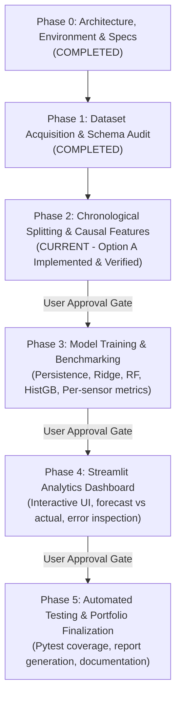

# Project Specification — Smart Traffic Forecasting and Congestion Analytics

**Document Version:** 1.2.0 (Phase 2 Verified)  
**Author:** AI/ML Engineering Pair (Antigravity & Student Intern)  
**Target Program:** ExcelR AI/ML Internship Portfolio  
**Status:** Phase 2 Complete (Awaiting Approval for Phase 3)

---

## 1. Executive Summary

The **Smart Traffic Forecasting and Congestion Analytics** project is an end-to-end, production-grade machine learning system designed to analyze and predict historical road network traffic measurements. Accurate traffic prediction is vital for municipal traffic planning, intelligent transportation systems (ITS), logistics management, and emission reduction strategies.

Developed as a capstone internship project for ExcelR, this repository follows professional software architecture standards: modular separation of concerns, strict time-series leakage prevention, CPU-optimized algorithms, automated testing, and comprehensive documentation.

> [!IMPORTANT]
> **Fundamental Project Boundary: Historical Forecasting vs. Live Monitoring**  
> This project operates on **verified historical benchmark datasets**. It is **not** a live telemetry or real-time GPS stream processor. All references to "forecasting" describe evaluating an algorithm's capability to predict future time steps using strictly prior observations from historical records.

---

## 2. Problem Statement and Objectives

### 2.1 The Core Problem
Transportation sensor networks record continuous time-series measurements of vehicle flow, occupancy, or speed across diverse highway and arterial segments. Predicting these metrics multiple steps into the future is inherently challenging due to:
- Complex non-linear diurnal (daily) and weekly cyclical patterns.
- Spatial and temporal autocorrelation across neighboring sensor stations.
- Sudden anomalies driven by bottlenecks, peak hours, or adverse weather conditions.

### 2.2 Project Objectives & Verified Horizons

1. **Multi-Sensor Highway Forecasting (Dataset A — UCI 734):**
   - **Nominal/Author-Described Task:** 15-minute-ahead traffic volume forecasting.
   - **Empirically Verified Target Horizon:** Mathematical data forensics confirms that the target variable `tra_Y[:, t]` aligns with `lag[9]` at offset $+2$, representing **2 quarter-hours (30 minutes) ahead of the latest input feature**.
   - **Prediction Target:** Normalized traffic flow/volume in $[0.0, 1.0]$ across 36 sensor stations along major Northern Virginia / Washington D.C. highway corridors.
2. **Weather-Aware Highway Volume Benchmark (Dataset B — UCI 492):**
   - In a completely isolated experimental pipeline, evaluate whether historical weather variables improve **1-hour-ahead** traffic volume forecasts on the Interstate 94 corridor in Minneapolis-St. Paul, MN.
3. **Multi-Model Rigorous Comparison:**
   - Benchmark machine learning models (Ridge Regression, Random Forest, and Histogram-based Gradient Boosting) against an unyielding Naive Persistence baseline ($\hat{y}_{\text{persistence}} = y_{\text{latest}}$).
4. **Leakage-Free Chronological Validation:**
   - Enforce strict temporal splits:
     - **Dataset A (Option A — Benchmark Aligned):** 1,000 training steps (47.6%), 261 validation steps (12.4%), and 840 official test steps (40.0%).
     - **Dataset B:** 70% train (28,284 hours), 15% validation (6,060 hours), and 15% test (6,062 hours).
   - All scalers, imputers, and rolling statistics are calculated strictly on preceding training periods with zero lookahead bias.
5. **Interactive Analytics and Decision Dashboard:**
   - Provide traffic engineers and stakeholders with an intuitive Streamlit interface to visualize trends, inspect per-sensor errors, examine peak traffic periods, and review pipeline limitations.

---

## 3. System Scope and Boundaries

| Dimension | In-Scope (Implemented & Supported) | Out-of-Scope (Strictly Excluded) |
| :--- | :--- | :--- |
| **Data Nature** | Historical sensor logs (15-min and 1-hour intervals) from verified public repositories | Live traffic camera scraping, real-time GPS feeds, simulated dummy data |
| **Prediction Horizon** | Verified: 30 minutes ahead of latest input feature for Dataset A; 1 hour ahead for Dataset B | Long-term forecasting (e.g., 6 months ahead), dynamic road routing / pathfinding |
| **Compute Constraints** | CPU-first optimization (Intel Iris Xe, 16 GB RAM, vectorization, scikit-learn) | Multi-GPU distributed training clusters, cloud-only vendor lock-in |
| **Congestion Definition** | Statistically defined high-volume/peak percentiles (explicitly documented) | Unsubstantiated claims of physical traffic jams without speed/capacity ground truth |
| **Model Scope** | Persistence baseline, Regularized Linear (Ridge), Tree Ensembles (RF, HistGB) | Opaque, un-benchmarked deep neural networks before simpler baselines are evaluated |

---

## 4. Phase-by-Phase Roadmap and Approval Gates

